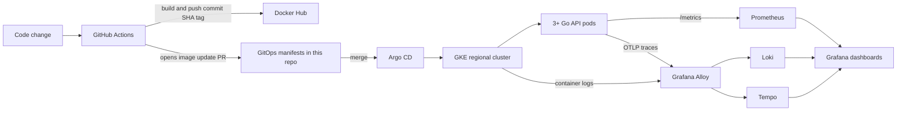

# Production-ready Go service: DevOps assignment

This repository takes the supplied Go greeting API and packages the production delivery path around it: a hardened container, resilient Kubernetes workload, GKE infrastructure as code, Argo CD GitOps deployment, centralized observability, CI image promotion, and an Ansible host setup.

The application serves `GET /?name=...` on port `8080` (names are limited to 100 bytes). It also exposes `/healthz`, `/readyz`, and Prometheus metrics at `/metrics`. OpenTelemetry traces are sent to Alloy when `OTEL_EXPORTER_OTLP_ENDPOINT` is configured; structured request logs go to standard output for collection by Alloy.

## Architecture



## Repository layout

| Path | Purpose |
|---|---|
| `Dockerfile`, `.dockerignore`, `scripts/publish-image.sh` | Multi-stage Docker Hardened Image build and versioned Docker Hub publishing. |
| `infra/k8s/base` | Reusable Deployment, Service, HPA, PDB, ServiceMonitor, and service account. |
| `infra/k8s/overlays/prod` | Production overlay with zone spreading. |
| `infra/terraform` | Custom VPC/subnet, Cloud NAT, regional private-node GKE cluster, node pool, and least-privilege node identity. |
| `infra/argocd` | Declarative Argo CD Application pointed at this fork. |
| `.github/workflows` | Build/push workflow that raises a GitOps image promotion PR. |
| `observability` | Prometheus/Grafana, Loki, Tempo, Alloy settings and a prebuilt dashboard. |
| `ansible` | Docker, NGINX, log rotation, and Node Exporter configuration for Ubuntu/Debian hosts. |
| `docs/INTERVIEW_NOTES.md` | Concise explanations of the design and likely interview questions. |

For the full workflow, install Go 1.26+, Docker with Buildx, Kustomize, `kubectl`, Terraform 1.8+, `gcloud`, Helm 3+, and Ansible. The service uses current OpenTelemetry Go packages that require Go 1.26; the build toolchain is therefore newer than the starter's Go 1.21.4 declaration.

## 1. Build and publish the container

The Dockerfile compiles a static Go binary in a builder stage, then copies only that binary into Docker's minimal static runtime image. The runtime process uses UID/GID `65532`, and the image has no shell or package manager. Docker Hardened Images require a Docker account login to `dhi.io`; Docker's Go example documents this multi-stage builder/runtime pattern and the registry login requirement ([DHI usage guide](https://docs.docker.com/dhi/how-to/use/)).

Create a Docker Hub repository named `hello-api` and make it public so GKE can pull the image without a registry secret. Then sign in to both registries:

```sh
docker login dhi.io
docker login
```

Build and push a commit-specific tag (the script defaults to the current Git commit SHA; it rejects `latest`):

```sh
export DOCKERHUB_USERNAME="your-dockerhub-username"
export IMAGE_TAG="$(git rev-parse --short=12 HEAD)"
./scripts/publish-image.sh
```

For a named release, set `IMAGE_TAG=0.1.0` before running the script. The script targets `linux/amd64`, matching the default GKE node architecture. The image URL is `https://hub.docker.com/r/<your-dockerhub-username>/hello-api`.

To run the image locally after publishing:

```sh
docker run --rm -p 8080:8080 "docker.io/${DOCKERHUB_USERNAME}/hello-api:${IMAGE_TAG}"
curl 'http://localhost:8080/?name=Codex'
curl http://localhost:8080/healthz
curl http://localhost:8080/metrics
```

## 2. Deploy with Kustomize

The base is reusable; production values live in an overlay. It sets three initial replicas, scales from three to ten based on CPU, uses startup/liveness/readiness probes, keeps two replicas available during voluntary disruptions, performs zero-unavailable rolling updates, and spreads pods across hosts and zones. The pod runs as non-root with a read-only filesystem, dropped Linux capabilities, seccomp `RuntimeDefault`, and no automatically mounted Kubernetes API token.

Set the image name and tag in `infra/k8s/base/kustomization.yaml` (the CI workflow updates these fields for you), then render or deploy:

```sh
cd infra/k8s/base
kustomize edit set image "hello-api=docker.io/${DOCKERHUB_USERNAME}/hello-api:${IMAGE_TAG}"
cd ../../..
kubectl kustomize infra/k8s/overlays/prod
kubectl apply -k infra/k8s/overlays/prod
```

The Service is `ClusterIP` so it stays internal. For a quick demo, use `kubectl -n hello-api port-forward svc/hello-api 8080:8080` and query `http://localhost:8080/`. A public endpoint, TLS, DNS, and ingress policy depend on the target environment and are intentionally left as deployment-specific choices.

## 3. Create the GKE infrastructure

The Terraform config creates a custom regional VPC and subnet, dedicated pod/service secondary ranges, Private Google Access, Cloud Router/NAT for private node egress, a regional GKE control plane, and an autoscaled regional node pool. Worker nodes have no public IPs. The control-plane endpoint is public but restricted to the CIDRs you provide. Google recommends private GKE nodes and Workload Identity Federation for workloads ([GKE networking guidance](https://cloud.google.com/kubernetes-engine/docs/best-practices/networking), [GKE identity guidance](https://cloud.google.com/kubernetes-engine/docs/concepts/workload-identity)).

The cluster has Workload Identity Federation enabled. The sample API needs no Google Cloud API access, so it receives no cloud role or key. If it later needs a Google API, bind a dedicated Kubernetes service account to a Google service account and grant only the required role; do not create or mount a service-account key file.

Requirements: Terraform, `gcloud`, a Google Cloud project with billing enabled, and permission to enable APIs, create networking/GKE resources, and grant IAM roles. Applying Terraform creates billable GKE, VM, NAT, and disk resources.

```sh
gcloud auth application-default login
cd infra/terraform
cp terraform.tfvars.example terraform.tfvars
```

Edit `terraform.tfvars`: set the real `project_id` and your current public IPv4 address with `/32` in `master_authorized_cidrs`. Avoid `0.0.0.0/0`.

```sh
terraform init
terraform fmt -recursive
terraform validate
terraform plan -out=tfplan
terraform apply tfplan
```

After apply, use the `connect_command` Terraform output to configure `kubectl`. When finished, remove billable resources with `terraform destroy` from `infra/terraform`. Before using this as a shared team environment, configure a versioned GCS Terraform backend and a protected production deletion policy.

The Terraform network uses GKE Dataplane V2, VPC-native pod/service ranges, Shielded Nodes, the Regular release channel, and a dedicated node service account with GKE's required `roles/container.defaultNodeServiceAccount` role ([Google Cloud guidance](https://cloud.google.com/kubernetes-engine/security/configure-node-service-accounts)). Workload Identity Federation avoids distributing generated GCP access keys to pods. Private nodes use Cloud NAT for outbound access; no node IP is directly exposed to the internet.

## 4. Install observability

`observability/install.sh` installs Prometheus and Grafana from `kube-prometheus-stack`, Loki for logs, Tempo for traces, and Grafana Alloy to collect Kubernetes logs and receive OTLP traces. The dashboard is provisioned from `hello-api-dashboard.yaml` and shows app request rate, ready pod count, restarts, logs, and traces. The app's ServiceMonitor feeds Prometheus; Kubernetes node and workload metrics come from the Prometheus stack.

Install the chart stack before applying the app through Argo CD because the app includes a Prometheus Operator `ServiceMonitor` custom resource. Provide Grafana's initial admin password without storing it in Git:

```sh
read -s -r -p "Grafana admin password: " GRAFANA_ADMIN_PASSWORD
export GRAFANA_ADMIN_PASSWORD
printf '\n'
./observability/install.sh
unset GRAFANA_ADMIN_PASSWORD
```

Open Grafana locally:

```sh
kubectl -n observability port-forward svc/kube-prometheus-stack-grafana 3000:80
```

Then visit `http://localhost:3000` and sign in as `admin` with the password you entered. The Loki and Tempo values use one replica and persistent local disks to keep this assignment self-contained; production needs replicated services and durable object storage such as GCS. Loki/Tempo chart behavior and the current chart repository are documented in the [Loki monolithic install guide](https://grafana.com/docs/loki/latest/setup/install/helm/install-monolithic/) and [Tempo Kubernetes Helm guide](https://grafana.com/docs/tempo/latest/set-up-for-tracing/setup-tempo/deploy/kubernetes/helm-chart/).

## 5. Deploy with Argo CD

Install Argo CD in the cluster using its [official installation guide](https://argo-cd.readthedocs.io/en/stable/getting_started/). This fork is public, so Argo CD can read it without a repository credential. The manifest points to `https://github.com/vimrul/devops-assignment.git` and watches `infra/k8s/overlays/prod`.

```sh
kubectl apply -n argocd -f infra/argocd/hello-api.yaml
```

After it is created, Argo CD reconciles the production overlay, prunes removed resources, and self-heals live changes. For a private fork, first configure a repository credential in Argo CD.

## 6. Build and promote through GitOps

Configure these repository Actions settings:

| Setting | Value |
|---|---|
| Repository variable `DOCKERHUB_USERNAME` | Your Docker Hub username. |
| Repository secret `DOCKERHUB_TOKEN` | A Docker Hub access token with permission to push the `hello-api` repository and authenticate to `dhi.io`. |

When source or container files change on `main`, the workflow compiles the Go service, builds and pushes a `linux/amd64` image tagged with the full commit SHA, and opens a pull request that updates the Kustomize image reference. Review and merge that PR; Argo CD then deploys the exact image represented by the Git commit. No `latest` tag is used. This separates building from production promotion and gives the deployment change a reviewable Git history.

If you add the Docker Hub settings after the code has already reached `main`, run **Build and promote image** manually from the GitHub Actions tab on the `main` branch.

## 7. Configure a Linux host with Ansible

The playbook targets Ubuntu/Debian hosts. It upgrades OS packages, installs Docker, configures `json-file` log rotation to 10 MB × 3 files, runs pinned NGINX with a rendered HTML page and restart policy `always`, and installs pinned Node Exporter as a systemd service under a dedicated non-login account.

```sh
cd ansible
ansible-galaxy collection install -r requirements.yml
cp inventory.ini.example inventory.ini
```

Replace the example host address/user and select the appropriate SSH key in `inventory.ini`, then run:

```sh
ansible-playbook -i inventory.ini site.yml --become
```

NGINX is published on host port `8081`; Node Exporter listens on `9100`. Restrict those ports with the host/cloud firewall to the intended clients, especially Node Exporter.

## Validation and cleanup

Useful local checks:

```sh
go build ./...
kubectl kustomize infra/k8s/overlays/prod
terraform -chdir=infra/terraform fmt -check -recursive
terraform -chdir=infra/terraform validate
ansible-playbook -i ansible/inventory.ini.example ansible/site.yml --syntax-check
```

The full cloud deployment is intentionally opt-in: it needs your Google Cloud project, Docker Hub credentials, an Ansible target, and billed infrastructure. After a GKE demo, run `terraform destroy`. Remove the Helm releases and namespaces if you want to clean observability separately.
